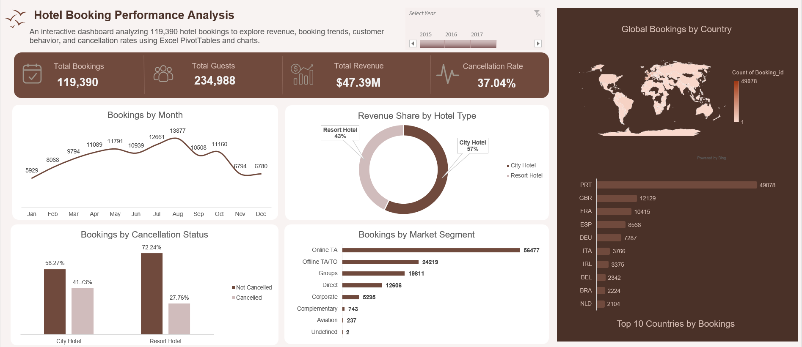

# Hotel Booking Analysis – Excel Dashboard

## Project Overview

This project analyzes hotel booking data to explore booking trends, revenue performance, and cancellation patterns across different hotel types.

The analysis was conducted using Microsoft Excel, with an interactive dashboard to present key findings and business insights.

## Project Objectives

* Analyze hotel booking trends over time.
* Evaluate revenue performance.
* Identify booking cancellation patterns.
* Compare City Hotel and Resort Hotel performance.
* Present key metrics through an interactive dashboard.

## Tools & Technologies

* Microsoft Excel
* Pivot Tables & Pivot Charts
* Excel Formulas
* Slicers
* Data Cleaning
* Data Visualization

## Key Metrics

| Metric            |      Result |
| ----------------- | ----------: |
| Total Bookings    |     119,390 |
| Total Revenue     | $47,385,403 |
| Cancellation Rate |      37.04% |

## Key Findings

* City Hotels accounted for 79,330 bookings.
* Resort Hotels accounted for 40,060 bookings.
* City Hotels generated approximately 57% of total revenue.
* Resort Hotels achieved a higher average revenue per booking.
* The overall booking cancellation rate was 37.04%.

## Dashboard Preview

The interactive Excel dashboard provides an overview of hotel performance, including booking trends, revenue distribution, and cancellation analysis.

## Project Files

Project files and dashboard screenshots are available in this repository.

## Author

**Faris Mohamed**

Management Information Systems Graduate | Aspiring Data Analyst

[GitHub Profile](https://github.com/FaresMohamed18)
